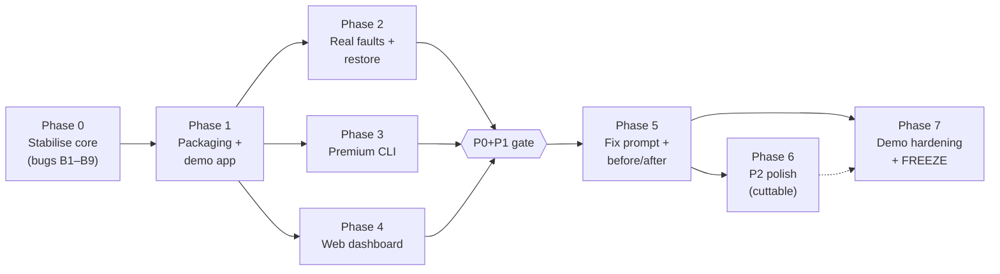

# BlastRadius: Phase Plan

> Build plan derived from `plan.md` + `implementation.md`, grounded in an audit of the code currently in this repo (commit `1555d8b`, "backend ka trial").
> **Rule:** a phase is done only when its exit criteria pass on the demo laptop. A plan or a commit is not enough.


> **Superseded in part by [PRD.md](PRD.md):** storage is **PostgreSQL** (not SQLite) in the running app, the AI agent is a core feature, and team ownership is defined in PRD §13. Where they conflict, the PRD wins.

---

## Contents

1. [Where we stand (audit)](#1-where-we-stand-audit)
2. [Critical bugs to fix first](#2-critical-bugs-to-fix-first)
3. [Phase overview](#3-phase-overview)
4. [Phase 0: Stabilise the core](#phase-0--stabilise-the-core)
5. [Phase 1: Run it for real (packaging + demo app)](#phase-1--run-it-for-real-packaging--demo-app)
6. [Phase 2: Real fault injection + guaranteed restore](#phase-2--real-fault-injection--guaranteed-restore)
7. [Phase 3: Premium CLI (`br`)](#phase-3--premium-cli-br)
8. [Phase 4: Web dashboard](#phase-4--web-dashboard)
9. [Phase 5: Close the loop (fix prompt + before/after)](#phase-5--close-the-loop-fix-prompt--beforeafter)
10. [Phase 6: Diagnostics & polish (P2)](#phase-6--diagnostics--polish-p2)
11. [Phase 7: Demo hardening & freeze](#phase-7--demo-hardening--freeze)
12. [24-hour timeline](#12-24-hour-timeline)
13. [Premium CLI design spec](#13-premium-cli-design-spec)
14. [Definition of done (all phases)](#14-definition-of-done-all-phases)

---

## 1. Where we stand (audit)

**What exists:** a well-structured Python `core/` library (parser, graph, gaps, safety, controller, k6 runner, metrics, analysis, report, fix prompt, score, SQLite store), a FastAPI `backend/` (REST + SSE), and 10 test files (~2,500 lines).

**What does not exist yet:** `cli/`, `frontend/`, `demo-app/`, `docker-compose.yml`, `Makefile`, `README.md`, `pyproject.toml`, Dockerfiles, `.env.example`, and no k6 binary bundled anywhere.

> ⚠️ **The test suite was not run during this audit.** Running code from the cloned repo was blocked in this session. Everything below comes from reading the source. Step 0.1 is to run `pytest` and record the real results.

### 1.1 Status against `plan.md` §14

Legend: ✅ code exists and looks complete · 🟡 partial / unverified · 🔴 exists but broken · ❌ not started

| # | plan.md item | Pri | Status | Notes from the code |
|---|---|---|---|---|
| 1 | Compose parser + validation errors | P0 | ✅ | `core/parser/compose.py` (398 lines) + `test_parser.py` |
| 2 | Dependency graph (declared + inferred) | P0 | ✅ | `core/graph/{builder,edges,classify,impact}.py` + `test_graph.py` |
| 3 | React Flow graph UI | P0 | ❌ | No `frontend/` |
| 4 | k6 load runner with hard limits | P0 | 🟡 | `core/load/runner.py` + template exist. Never run against a live target. **Silently switches to fabricated data when k6 is missing** (see B1) |
| 5 | Live charts via SSE | P0 | 🟡 | SSE endpoint exists (`backend/app/api/stream.py`); no charts |
| 6 | Persistence + basic report | P0 | 🟡 | SQLite store (plan says Postgres for the server; SQLite is fine for the hackathon, so make it the official decision). Report builder exists |
| 7 | Demo app (5 services) | P0 | ❌ | Only `tests/fixtures/demo-compose.yaml` |
| 8 | CLI: `br run`, `br report`, `--json`, Ctrl+C | P0 | ❌ | No `cli/` |
| 9 | 9-point preflight | P1 | 🟡 | `core/safety/preflight.py` (467 lines). The live app never passes a Docker client to it |
| 10 | Redis stop/restore + guaranteed restore | P1 | 🔴 | See B2–B4: no Docker client wired, errors swallowed, no labels re-checked, no watchdog |
| 11 | Phase-segmented metrics | P1 | 🟡 | `core/analysis/phases.py` |
| 12 | Measured recovery time | P1 | 🟡 | Uses the *scheduled* restore time, not the actual one; ignores configured `recovery_stable_s` / `recovery_timeout_s` (B5) |
| 13 | Evidence-based graph highlighting | P1 | 🔴 | Controller calls `build_evidence()` with the wrong arguments, so every fault run crashes (B3). No UI |
| 14 | Load ramp + breaking point | P1 | 🟡 | `core/analysis/slo.py`, schedule supports multipliers |
| 15 | Kill switch everywhere | P1 | 🟡 | API abort exists. Aborted runs produce no report (B6). No CLI or UI |
| 16 | Fix prompt + `--fix-prompt` | P1 | 🟡 | `core/report/fix_prompt.py` + `GET /reports/{id}/fix-prompt` |
| 17 | Before/after re-test | P1 | 🟡 | `core/analysis/compare.py` + `POST /reports/compare`; no "re-run same config" flow |
| 18 | CLI live output, exit codes, parse/abort/reset/status/logs | P1 | ❌ | |
| 19 | Compose gap analysis | P1 | ✅ | `core/graph/gaps.py` (UI badges pending) |
| 20–23 | docker stats, pool diagnostics, bottleneck, Toxiproxy | P2 | ❌ | |
| 24 | Resilience score | P2 | 🟡 | Already built (`core/report/score.py`). Built before the P1 items it depends on |
| 25–28 | History compare, Gemini, history page, CLI extras | P2 | ❌ | |

### 1.2 Gate status

| Gate (plan.md) | Status |
|---|---|
| **P0 gate:** upload → graph → load test → live charts → saved report | ❌ Not reachable: no UI, no demo app, no CLI, k6 never exercised live |
| **P1 gate:** map → break → recover → ramp → report → fix prompt → before/after | ❌ Fault path is broken |
| **Freeze** | — |

**Honest summary:** the *brain* (core analysis) is strong. The *hands* (real faults, real load against a real app) and the *faces* (CLI + dashboard) are missing. The plan below fixes the hands first, because a beautiful UI over fake numbers would break the product's core promise.

---

## 2. Critical bugs to fix first

These break `plan.md`'s ground rules ("honest numbers or no numbers", "guaranteed restore"). Fix them before any new feature.

| ID | Severity | Where | Problem | Fix |
|---|---|---|---|---|
| **B1** | 🔴 Critical (honesty) | `core/controller/experiment.py:138–206, 426` | If `k6` is not on PATH, the controller **silently fabricates** requests (`_simulate_second`: fixed 25 ms, 50% errors during fault) and labels the report `data_source="live"`. A judge would see invented numbers presented as measurements. | Missing k6 → state `FAILED`, reason "k6 not installed". Move the simulator behind an explicit `--simulate` / `BR_SIMULATE=1` flag, set `data_source="simulated"` (add to the schema), and show a `SIMULATED` badge everywhere. |
| **B2** | 🔴 Critical (faults don't happen) | `backend/app/main.py:57`, `backend/app/state.py:121` | `create_live_state()` is called with no `docker_client`, so `_inject_fault` only records a set entry. **Redis is never actually stopped.** | Build the client at startup with `docker.from_env()`. If Docker is unreachable, fault experiments fail preflight (they already would, via check 1). |
| **B3** | 🔴 Critical (crash) | `core/controller/experiment.py:390` | `build_evidence(..., declared_services=[...])` doesn't match the signature (`service_endpoints`, `window_start`, `window_end` required). The resulting `TypeError` is raised *outside* the try block, so every fault run crashes after the `finally`, leaves state `RUNNING`, and saves no report. | Pass an endpoint→service map (from the experiment config / demo-app manifest) and real window timestamps. Add a controller test for the full fault path that asserts a report is saved. |
| **B4** | 🔴 Critical (safety) | `core/controller/experiment.py:281–306` | Fault injection: does not re-check labels/allowlist at call time (implementation.md invariant #6); swallows every exception (`except: pass`), so a failed stop is reported as a fault; never writes `blastradius.faulted-by` labels, so `reset` and the startup sweep can't find faulted containers; no watchdog; no startup sweep. | New `core/faults/injector.py` + `watchdog.py` per implementation.md B2/B3. Failed inject → experiment `FAILED`. Record the **actual** inject/restore timestamps. |
| **B5** | 🟠 High (wrong numbers) | `core/controller/experiment.py:380–381` | Recovery measured from the *scheduled* restore second, and `recovery_stable_s` / `recovery_timeout_s` from the config are ignored. | Use the actual restore timestamp; pass `stable_s` and `timeout_s` through. |
| **B6** | 🟠 High | `core/controller/experiment.py:256–259` | On abort, `CancelledError` is re-raised, so no report is written for aborted runs. Abort also races: it sets `ABORTED` while the task may still write state. | Catch the cancellation, finalise a partial report with `final_state=ABORTED`, then exit cleanly. Make the task the single writer of state. |
| **B7** | 🟡 Medium | `core/controller/experiment.py:411–421` | `baseline_vs_fault` compares `p_stats[0]` with `p_stats[1]` regardless of type. For capacity runs it compares 1× to 2× and calls that "fault". | Only compute it for fault runs, and look phases up by name. |
| **B8** ✅ done | 🟡 Medium | repo root | `BLASTRADIUS (1).md` is a stale copy of an earlier spec (wrong section numbers, contradicts `plan.md` on CLI name and exit codes). | Make `plan.md` the source of truth; delete or archive the duplicate. |
| **B9** | 🟡 Medium | `requirements.txt` | Missing `pytest`, `typer`, `rich`, `prompt_toolkit`; no `pyproject.toml`, so there's no `br` entry point. | Phase 1. |

---

## 3. Phase overview



Phases 2, 3, and 4 can run **in parallel** once Phase 1 lands, since they touch separate folders (`core/faults`, `cli/`, `frontend/`).

| Phase | Goal | Maps to plan.md | Owner (plan.md §3) | Time box |
|---|---|---|---|---|
| 0 | Core tells the truth and doesn't crash | Ground rules 2, 6 | Backend/core | 2 h |
| 1 | One command starts a real stack; k6 measures a real app | P0 #4, #6, #7 | Infra + Demo | 3 h |
| 2 | Redis really stops, really comes back, every time | P1 #9, #10, #12, #13, #15 | Load/fault/infra | 3 h |
| 3 | `br` CLI that feels like a premium product | P0 #8, P1 #18 | Backend/core | 4 h |
| 4 | Dashboard: graph, live charts, report | P0 #3, #5, P1 #13 | Frontend | 6 h |
| 5 | Fix prompt + same-config re-test | P1 #16, #17 | Backend + Frontend | 2 h |
| 6 | Diagnostics, bottleneck, score, AI | P2 #20–28 | Whoever is free | Leftover only |
| 7 | Rehearsed, recorded, frozen | Demo discipline | Demo/pitch | 3 h |

---

## Phase 0: Stabilise the core

**Goal:** the existing core is honest, passes its tests, and never fabricates data.

| Step | Task | Files |
|---|---|---|
| 0.1 | Create venv, install deps, run `pytest -q`; paste the real results into §1 | — |
| 0.2 | **B1**: remove silent simulation; add explicit `--simulate` mode with `data_source="simulated"` | `core/controller/experiment.py`, `core/schemas/report.py` |
| 0.3 | **B3**: fix the `build_evidence` call; add an endpoint→service map to `ExperimentCreate` (or the demo manifest) | `core/controller/experiment.py`, `core/schemas/experiment.py` |
| 0.4 | **B5, B6, B7**: actual restore timestamp, config-driven recovery, abort writes a partial report, phase-keyed deltas | `core/controller/experiment.py` |
| 0.5 | New test: full fault-path controller run (simulated mode) → report saved, state `COMPLETED`, evidence present | `tests/test_controller_and_preflight.py` |
| 0.6 | ✅ **B8** done: stale copy removed; docs moved to `docs/` and linked from README | — |
| 0.7 | **B10**: 9 of 10 test files are scripts with `main()`, so `pytest` collects only 3 tests out of ~325 checks. Add `def test_all(): assert main() == 0` to each (details in [PROGRESS_REPORT.md §5.2](PROGRESS_REPORT.md#52-two-problems-in-the-existing-tests)) | `tests/*.py` |

**Exit criteria**
- [ ] `pytest -q` green, with results recorded
- [ ] Without k6 and without `--simulate`, a run fails with "k6 not installed" and produces no numbers
- [ ] A simulated run is labelled `SIMULATED` in the report JSON
- [ ] Fault-path test produces a saved report

---

## Phase 1: Run it for real (packaging + demo app)

**Goal:** `make up` → real demo app + control plane; a 30 s capacity run against it produces a report from **real k6 samples**.

| Step | Task |
|---|---|
| 1.1 | `pyproject.toml` with `[project.scripts] br = "cli.main:app"`; dev extras `pytest`, `pytest-asyncio`; runtime adds `typer`, `rich`, `prompt_toolkit` |
| 1.2 | `demo-app/` per plan.md §11: Express API (`/health`, `/health/live`, `/api/products`, `/api/cart/:id`, `/api/checkout-preview`, `/api/products-cached`, `/api/slow`, `/api/cpu`, `/metrics`), worker, Redis, Postgres with synthetic seed, tiny frontend. `PG_POOL_MAX=10`. Labels `blastradius.env=test`; Redis gets `blastradius.fault-allowed=true`. Leave some healthchecks/limits out on purpose so gap analysis finds real issues |
| 1.3 | `demo-app/endpoints.yaml`: the endpoint→service map that evidence attribution needs (fixes B3 properly) |
| 1.4 | `backend/Dockerfile` with the k6 binary installed (pinned version) |
| 1.5 | Root `docker-compose.yml` (control plane, binds `127.0.0.1` only, mounts the Docker socket) + `.env.example` (allowlists, caps) |
| 1.6 | `Makefile`: `up`, `down`, `demo`, `test`, `test-integration`, `reset` |
| 1.7 | Integration test T17: 10 s at 10 RPS → k6 sample count ≈ demo-api request counter (±2%) |
| 1.8 | Decision recorded: **SQLite** for hackathon storage (one file, zero ops). Postgres stays the post-hackathon target |

**Exit criteria**
- [ ] `make up` on the demo laptop (Windows + WSL2 Docker) brings everything up healthy
- [ ] `curl 127.0.0.1:3000/health` → `{"status":"ok","redis":"ok","db":"ok"}`
- [ ] A capacity run via the API produces a report whose request count matches the demo API counter
- [ ] Gap analysis on `demo-app/compose.yaml` flags at least 2 real findings

---

## Phase 2: Real fault injection + guaranteed restore

**Goal:** stop Redis under load → measured impact → restore → measured recovery. Reliable 10/10 times.

| Step | Task |
|---|---|
| 2.1 | `core/faults/injector.py`: resolve container → **re-check** allowlist + labels at call time → `stop(timeout=5)` → add `blastradius.faulted-by=<id>` tracking (Docker can't relabel a running container, so keep a sidecar JSON ledger at `~/.blastradius/faults.json` *and* an in-memory set) → return actual timestamp. Raise on failure; never swallow |
| 2.2 | `core/faults/watchdog.py`: per-fault asyncio timer (hard cap 120 s) |
| 2.3 | Startup sweep in the backend lifespan + `POST /api/system/reset` → restore everything in the ledger |
| 2.4 | Wire `docker.from_env()` into `create_live_state` (B2) |
| 2.5 | Integration tests T19–T21: Redis stop → `/api/cart` errors > 50% + evidence for `demo-api`; restore → recovery time recorded; abort mid-fault → Redis running |
| 2.6 | Run the fault experiment 10× in a row; record recovery times and variance |

**Exit criteria**
- [ ] 10/10 runs: Redis is running at the end, report saved, evidence attributes impact to `demo-api` only through measured endpoints
- [ ] `kill -9` the backend mid-fault → restart → Redis restored by the sweep
- [ ] Preflight blocks: unlabelled container, `NODE_ENV=production`, non-allowlisted host, `demo-postgres` as a target

---

## Phase 3: Premium CLI (`br`)

**Goal:** a CLI that judges remember. It should feel as polished as a modern AI-agent terminal app (calm, typographic, conversational), with its own BlastRadius identity. Full spec in [§13](#13-premium-cli-design-spec).

**Two modes, one binary:**

| Mode | Invocation | For |
|---|---|---|
| **Interactive** | `br` (no args) | Humans. Full-screen-feel REPL with slash commands, live panels, confirmations |
| **Command** | `br run …`, `br parse …` | Scripts and CI. Same renderers, `--json` and `--plain` for machines |

| Step | Task | Priority |
|---|---|---|
| 3.1 | `cli/` skeleton: Typer app, `theme.py` (palette + glyphs), `render/` (Rich renderers), `client.py` (standalone in-process controller **or** `--remote URL` over REST/SSE) | P0 |
| 3.2 | `br parse <file>`: branded header, service tree with edge sources, gap findings, `--json` | P0 |
| 3.3 | `br run <config.yaml>`: preflight checklist animation → live dashboard (phase bar, metric tiles, sparklines, service states, evidence feed) → summary card → exit code | P0 |
| 3.4 | Ctrl+C → abort path with visible "Restoring demo-redis…" spinner → exit 1/2 | P0 |
| 3.5 | `br report <id>` (+ `--md -o`, `--fix-prompt` with a copy-to-clipboard hint) | P0 |
| 3.6 | Interactive REPL: `prompt_toolkit` input with slash-command completion (`/parse`, `/run`, `/fault`, `/ramp`, `/report`, `/fix`, `/abort`, `/status`, `/history`, `/help`, `/exit`), bottom status line, `?` for shortcuts | P1 |
| 3.7 | Permission-style confirmation before any fault (numbered choices, see §13.5) | P1 |
| 3.8 | `br status`, `br logs <id> -f`, `br abort`, `br reset`, `br history`, `br compare a b`, `br demo up/down` | P1 / P2 |
| 3.9 | Tests: Typer `CliRunner` for exit codes (0 pass / 1 breach / 2 error, per plan.md), `--json` schema, `--plain` has no ANSI, Ctrl+C restores (integration) | P1 |

**Exit criteria**
- [ ] Fresh terminal: `br` → welcome screen → `/run experiments/redis-fault.yaml` → confirmation → live view → report, with no traceback anywhere
- [ ] `br run … --json` emits valid JSON only; exit code matches outcome
- [ ] Renders correctly in Windows Terminal, VS Code terminal, and an 80-column window; degrades cleanly with `NO_COLOR=1`
- [ ] Run started from the CLI with `--remote` is visible live in the dashboard

---

## Phase 4: Web dashboard

**Goal:** plan.md §6.2 pages, fed only by real API data.

| Step | Task | Priority |
|---|---|---|
| 4.1 | Vite + React + TS + Tailwind scaffold; typed API client generated from FastAPI OpenAPI; SSE hook with polling fallback | P0 |
| 4.2 | **Architecture page:** YAML upload/paste, inline validation errors, React Flow + dagre, edge styles (solid/dashed/amber), red dashed gap badges, inspector | P0 |
| 4.3 | **Experiment live page:** header strip, phase timeline, live graph states, stacked Recharts (RPS, latency + SLO line, errors + SLO line) with phase bands, evidence feed, kill switch | P0 |
| 4.4 | **Traffic Twin page:** config form validated against `/api/limits`, k6 script preview, step charts with breach markers, highest-pass / first-breach card | P1 |
| 4.5 | **Report page:** phase table, verified vs predicted, recovery, capacity, limitations, recommendations, fix-prompt panel with Copy | P1 |
| 4.6 | Status badges = colour + icon + text (component test T23) | P1 |
| 4.7 | `SIMULATED` / `RECORDED` badge whenever `data_source != "live"` | P0 |

**Exit criteria**
- [ ] Upload `demo-app/compose.yaml` → graph with declared + inferred edges + gap badges
- [ ] Live fault run: the `demo-api` node turns "Impact observed" only after an evidence event arrives
- [ ] Every number on screen traceable to a stored bucket or evidence row

---

## Phase 5: Close the loop (fix prompt + before/after)

| Step | Task |
|---|---|
| 5.1 | `POST /api/experiments/{id}/rerun`: clone config verbatim, set `compared_to`, full preflight |
| 5.2 | Fairness check: different CPU/mem limits or load config → warning stamped on the comparison |
| 5.3 | `demo-app` "fixed" variant (e.g. `/api/cart` with Redis fallback, retry/backoff), switched via env var, so the before/after story is real and repeatable |
| 5.4 | Before/After page + `br compare a b` diff table (green/red deltas with arrows **and** words) |

**Exit criteria (= P1 gate)**
- [ ] Full loop runs end to end: map → break → recover → ramp → report → fix prompt → re-test shows a measured improvement

**Then: FEATURE FREEZE** for anything not in Phase 6.

---

## Phase 6: Diagnostics & polish (P2)

Only start once the P1 gate passes. Cut in this order (plan.md §14): Gemini → score → Toxiproxy → history compare → bottleneck classification → docker stats → ramp refinement.

- docker stats CPU/mem per service (`unavailable` + reason when the socket is denied)
- `pg_stat_activity` + `/metrics` pool gauges → `db_connection_exhaustion` rule
- Bottleneck classification (`unknown` by default)
- Toxiproxy latency, pause, stop-API scenarios
- Gemini explanations with a numeric grounding check
- Shell completion, config profiles

---

## Phase 7: Demo hardening & freeze

| Step | Task |
|---|---|
| 7.1 | Rehearse the 3-minute script (plan.md §16) 3× on the demo laptop, timed |
| 7.2 | Record one run, store it as `data_source="recorded"`, and verify the `RECORDED` badge shows in both CLI and UI |
| 7.3 | Backup video |
| 7.4 | Offline check: Wi-Fi off, `make up` still works (images pre-pulled) |
| 7.5 | README: setup, demo commands, honest status table (implemented / tested / simulated / planned) |
| 7.6 | Final `pytest` + integration run; paste results into README |

---

## 12. 24-hour timeline

| Hour | Backend/core | Load/fault/infra | Frontend | Demo/pitch |
|---|---|---|---|---|
| 0–2 | **Phase 0** bugs B1–B7 | 1.4–1.6 Dockerfile, compose, Makefile | 4.1 scaffold + API client | 1.2 demo API endpoints |
| 2–5 | 3.1–3.2 CLI skeleton + `br parse` | 1.7 k6 live parity test | 4.2 Architecture page | 1.2–1.3 demo stack + endpoint map |
| **5** | 🎯 **Checkpoint A:** real k6 run against demo app → saved report | | | |
| 5–9 | 3.3–3.5 `br run`, Ctrl+C, `br report` | **Phase 2** injector, watchdog, sweep | 4.3 live experiment page | Gap findings tuned; seed data |
| **9** | 🎯 **Checkpoint B (P0 gate):** upload → graph → load → live charts → report, in both CLI and web | | | |
| 9–13 | 3.6–3.7 REPL + confirmations | 2.5–2.6 fault integration ×10 | 4.4–4.5 Traffic Twin + Report | 5.3 "fixed" demo variant |
| 13–16 | **Phase 5** rerun + compare | Ramp tuning (pool breach reproducible) | 4.6–4.7 badges, before/after page | Pitch draft |
| **16** | 🎯 **Checkpoint C (P1 gate):** full loop. **FEATURE FREEZE** | | | |
| 16–20 | 3.8–3.9 CLI extras + tests | Phase 6 (only if green) | Polish, a11y | 7.1 rehearsal ×3 |
| 20–24 | Bug fixes only | 7.4 offline check | Bug fixes only | 7.2–7.6 recorded run, video, README |

**If behind at Checkpoint B:** drop the REPL (3.6), keep command mode. **If behind at C:** drop Traffic Twin page polish; the CLI ramp output + report page are enough.

---

## 13. Premium CLI design spec

The bar: it should feel like a modern AI-agent CLI (calm, generous whitespace, one accent colour, conversational status lines, nothing noisy) while staying clearly **BlastRadius**. It takes inspiration from that style without copying anyone's branding, logo, or wording.

### 13.1 Design principles

1. **Calm by default.** One accent colour, muted greys for chrome, colour reserved for *state*. No rainbow tables.
2. **Typography over boxes.** Rounded panels only for the header and the final summary. Everything else is indented text with thin `⎿` connectors.
3. **Every state = glyph + word + colour.** Never colour alone (works with `NO_COLOR`, colour-blind users, and screenshots).
4. **Motion means work.** A spinner appears only while something is actually happening, with a present-tense verb ("Stopping demo-redis…").
5. **Numbers in tabular monospace,** right-aligned, with units. Missing values print `n/a · <reason>`, never `0`.
6. **Same truth as the web.** Identical labels, states, and numbers. The CLI is a view, not a second implementation.

### 13.2 Palette & glyphs (`cli/theme.py`)

| Token | Hex | Use |
|---|---|---|
| `accent` | `#E8743B` (ember orange, "blast") | Brand mark, prompt caret, active phase |
| `text` | default fg | Body |
| `muted` | `#8A8F98` | Chrome, hints, timestamps |
| `ok` | `#3FB950` | Healthy, pass |
| `warn` | `#D29922` | Impact observed, near-threshold |
| `bad` | `#F85149` | Fault injected, breach, fail |
| `info` | `#58A6FF` | Under test, links |
| `recover` | `#2EA0A0` | Recovered |

| State | Glyph | Word |
|---|---|---|
| Healthy | `●` | `healthy` |
| Under test | `◎` | `under test` |
| Fault injected | `✕` | `fault injected` |
| Impact observed | `▲` | `impact observed` |
| Recovered | `↺` | `recovered 4.2s` |
| Unverified | `?` | `unverified` |
| Step / tool line | `⏺` then `⎿` | — |
| Thinking/working | `✻` spinner frames `· ✢ ✳ ✶ ✻ ✽` | verb + elapsed |

ASCII fallback (`--ascii` or non-UTF-8 terminal): `* o x ! ~ ?` and `|_`.

### 13.3 Welcome screen (`br`)

```text
╭────────────────────────────────────────────────────────────────╮
│ ✻ BlastRadius  v0.1.0                                          │
│                                                                │
│   Break it before production does.                             │
│                                                                │
│   cwd:     ~/cbs/blastradius                                   │
│   target:  demo-app (TEST · isolated · br-target)              │
│   engine:  k6 v0.5x · docker ✓ · store: .blastradius/br.db     │
╰────────────────────────────────────────────────────────────────╯

  Tips:
  1. /parse demo-app/compose.yaml   map your services
  2. /fault demo-redis              break something, safely
  3. /ramp                          find the breaking point

> █
  ? for shortcuts                                 ● demo-app healthy
```

### 13.4 Parse output

```text
> /parse demo-app/compose.yaml

⏺ Parsed demo-app/compose.yaml
  ⎿  5 services · 6 edges (4 declared, 2 inferred) · 3 gaps

  demo-frontend   frontend
  └─▶ demo-api        api        declared   depends_on
      ├─▶ demo-redis      cache      declared   depends_on
      └─▶ demo-postgres   database   declared   depends_on
  demo-worker     worker
  ├┄▶ demo-redis      cache      inferred   env REDIS_HOST=demo-redis
  └┄▶ demo-postgres   database   inferred   env DATABASE_URL=postgres://…@demo-postgres

  Gaps
  ▲ medium  demo-worker    no healthcheck            services.demo-worker.healthcheck
  ▲ medium  demo-postgres  single database (SPOF)    services.demo-postgres
  · low     demo-api       no resource limits        services.demo-api.deploy

  Compose describes configuration, not runtime. Inferred edges are heuristics.
```

### 13.5 Fault confirmation (permission-style)

```text
⏺ BlastRadius wants to stop a container

  ╭──────────────────────────────────────────────────────────────╮
  │ docker stop demo-redis                                       │
  │ for 20s under 20 RPS synthetic load, then docker start       │
  ╰──────────────────────────────────────────────────────────────╯
  Preflight  9/9 passed   (env label · allowlist · prod guard · isolation ·
                           load allowlist · limits · target health · lock · restore path)

  Do you want to proceed?
  ❯ 1. Yes
    2. Yes, and don't ask again for demo-redis this session
    3. No, show me the preflight details

  Esc to cancel
```

### 13.6 Live run view

```text
⏺ redis-fault · exp 7f3c                         fault · 1× · 20 rps target

  baseline ━━━━━━━━━━━━━━━━━━━━ fault ━━━━━━━━━━╸━━━━━━━━━ recovery ─────────
                                               ▲ 00:31

            rps       p50       p95       p99    errors
  baseline  20.0    <val>     <val>     <val>     <val>    ✓ within SLO
  fault     19.8    <val>     <val>     <val>     <val>    ✕ errors > 1%
  now       20.1    <val>     <val>     <val>     <val>
  p95  ▁▁▁▂▁▁▁▁▁▁▁▁▁▁▁▃▆█▇█▇██▇▆
  err  ▁▁▁▁▁▁▁▁▁▁▁▁▁▁▁▇████████

  ✕ demo-redis     fault injected
  ▲ demo-api       impact observed   /api/cart errors <base> → <fault>  n=<count>
  ● demo-postgres  healthy
  ? demo-worker    unverified        no worker metrics available

  ✻ Holding fault… 11s left                         ctrl+c abort & restore
```

`<val>` placeholders are filled only from live buckets. Sparklines use the last 30 s.

### 13.7 Summary card

```text
╭─ Result · redis-fault ─────────────────────────────────────────╮
│ ✕ SLO breached during fault       ↺ recovered in <n>s          │
│                                                                │
│ Verified impact   demo-api  (2 evidence items)                 │
│ Predicted, not observed   demo-worker (no metrics available)   │
│                                                                │
│ Top fix  [P1] Treat Redis as a soft dependency for /api/cart   │
╰────────────────────────────────────────────────────────────────╯
  br report 7f3c --fix-prompt   copy the fix for your AI agent
  br open 7f3c                  view in dashboard
  exit 1
```

### 13.8 Abort experience

```text
^C
⏺ Aborting redis-fault
  ⎿  ✓ stopped load generator (k6 pid 4121)
  ⎿  ✻ restoring demo-redis…
  ⎿  ✓ demo-redis running · health ok
  Partial report saved: br report 7f3c
```

Second Ctrl+C: exit immediately, print `br reset` as the recovery command.

### 13.9 Implementation notes

| Need | Library / technique |
|---|---|
| Panels, tables, trees, live region | `rich` (`Live`, `Panel(box=ROUNDED)`, `Table(box=None)`, `Tree`) |
| REPL input, slash completion, history, bottom toolbar | `prompt_toolkit` (`PromptSession`, `WordCompleter`, `bottom_toolbar`) |
| Numbered confirmation menus | `prompt_toolkit` key bindings (↑/↓/1–3/Enter/Esc) |
| Sparklines | 8-level block chars `▁▂▃▄▅▆▇█`, computed from bucket series |
| Spinner verbs | Rich `Status` with a custom spinner + per-phase verb table |
| Clipboard for fix prompt | `pyperclip` if available; otherwise print and say "copy above" |
| Machine modes | `--json` (no ANSI, one JSON document), `--plain` (line logs for CI), honour `NO_COLOR`, `TERM=dumb`, non-TTY auto-plain |
| Width | Design for 80 cols; tables collapse columns (p99 first) under 80 |

**File layout**

```
cli/
├── main.py            # Typer app; no args → REPL
├── repl.py            # prompt_toolkit session, slash commands, toolbar
├── theme.py           # palette, glyphs, ASCII fallback
├── client.py          # standalone (in-process core) | remote (REST + SSE)
├── commands/          # parse, run, report, abort, reset, status, logs, history, compare, demo
└── render/
    ├── header.py      # welcome panel
    ├── graph.py       # service tree
    ├── live.py        # live run view
    ├── confirm.py     # permission-style menu
    ├── summary.py     # result card
    └── sparkline.py
```

---

## 14. Definition of done (all phases)

- Tests for the phase pass, and the output is pasted into the PR / README.
- No number shown anywhere that isn't from a stored bucket, evidence row, or report field.
- Non-live data always shows `SIMULATED` or `RECORDED`.
- Every fault path ends with the container running (verified, not assumed).
- The status table in README is updated honestly: implemented / tested / simulated / planned.
