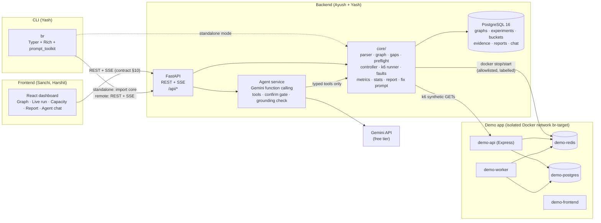

# BlastRadius: Product Requirements Document (PRD)

> **Break it before production does.**
> An AI reliability agent that maps your Docker Compose app, breaks it on purpose in a safe local sandbox, measures what really fails under real traffic, and hands you a proven, evidence-backed fix.

| | |
|---|---|
| **Event** | CBS 9.0 Hackathon (24 h) |
| **Version** | 1.0 (final for build) |
| **Budget** | **₹0 / $0.** Runs entirely on free and open-source software plus the Gemini API free tier |
| **Database** | PostgreSQL 16 (plain, self-hosted in Docker) |
| **Team** | Yash · Ayush (backend) · Sanchi · Harshit (frontend) |
| **Source of truth** | This PRD. `PHASE_PLAN.md` = build order; `PROGRESS_REPORT.md` = audit + test guide; `plan.md` / `implementation.md` = original design notes |

---

## Contents

1. [Judging criteria → how we win each one](#1-judging-criteria--how-we-win-each-one)
2. [Problem](#2-problem)
3. [Solution & value](#3-solution--value)
4. [Users & use cases](#4-users--use-cases)
5. [Goals, non-goals, success metrics](#5-goals-non-goals-success-metrics)
6. [Zero-cost stack](#6-zero-cost-stack)
7. [System architecture](#7-system-architecture)
8. [Functional requirements](#8-functional-requirements)
9. [AI agent specification](#9-ai-agent-specification)
10. [API contract (the connection points)](#10-api-contract-the-connection-points)
11. [Data model (PostgreSQL)](#11-data-model-postgresql)
12. [Non-functional requirements](#12-non-functional-requirements)
13. [Team split & ownership](#13-team-split--ownership)
14. [Build timeline (24 h)](#14-build-timeline-24-h)
15. [Testing & acceptance](#15-testing--acceptance)
16. [Demo script (3 min)](#16-demo-script-3-min)
17. [Risks](#17-risks)
18. [Current status](#18-current-status)
19. [Business model (post-hackathon)](#19-business-model-post-hackathon)

---

## 1. Judging criteria → how we win each one

Total 25 points. **Problem & Value is worth double** everything else, so the pitch opens with the problem, and every feature must trace back to it.

| Criterion | Pts | What judges ask | Our answer | Proof in demo |
|---|---:|---|---|---|
| **Problem & Value** | **10** | Is the problem clear? Meaningful value? | Small teams ship without knowing what breaks when a dependency dies or traffic spikes. Enterprise tools to find out are expensive and complex. BlastRadius answers in minutes, for free, with proof | Opening 30 s; "before vs after fix" result; capacity / right-sizing card |
| **Solution & Innovation** | 5 | Creative, effective, unique? | Combines **chaos testing + load testing + statistical proof + AI fix loop** in one free tool. Predicted vs verified impact is a distinct idea: the graph only lights up when measured | Graph lighting up on evidence; p-values; before/after |
| **AI / Agent Engineering** | 5 | Meaningful AI, effective tool use, edge cases? | A **Gemini agent with function calling** over 9 typed tools. It plans experiments, runs them only after human confirmation, explains results with citations, and writes the fix. Edge cases are handled explicitly: grounding check, confirmation gate, step cap, rate limits, prompt injection, offline fallback | Live chat in dashboard + `br ask` in terminal; a deliberately unsafe request being refused |
| **Demo & Communication** | 5 | Functional, clear, well explained? | One scripted 3-minute story, rehearsed 3×, with a labelled recorded fallback | §16 script |

**Rule for every feature decision:** if it doesn't make the demo story clearer or the value bigger, it waits.

---

## 2. Problem

**Every team ships hoping two things never happen: a dependency dies, or traffic spikes. Most find out in production.**

Small teams (startups, student projects, agencies) without a dedicated SRE can't answer these questions before deploying:

1. If Redis or the database goes down, **which features break**, and which keep working?
2. **How much traffic** can we take before latency or errors cross our limits?
3. After a failure, **how long until we recover**, or do we recover at all?
4. **Which fix actually helps?** And how do we prove it?

**Why they don't test today**

| Barrier | Reality |
|---|---|
| Cost | Chaos-engineering platforms (Gremlin, Steadybit) are sold by custom enterprise quote; hosted load testing (Grafana Cloud k6) bills per virtual-user hour |
| Two tools | Chaos and load testing are separate products with separate reports. Nobody connects them |
| Expertise | Open-source chaos tools (LitmusChaos, Chaos Mesh) need Kubernetes and SRE knowledge |
| No proof | Tools say *that* something broke, not *why*, not *what to do*, and not *whether the fix worked* |
| Risk | Running chaos against real infrastructure is scary, so nobody does it |

---

## 3. Solution & value

### 3.1 The loop

```
 MAP            BREAK              MEASURE               FIX                 PROVE
 compose  →  fault + load   →   statistical      →   AI fix prompt   →   re-run same test,
 graph       in a safe          evidence report       + patch idea        before/after
             local sandbox
 "What could   "What did          "How bad, how         "What to            "Did it
  break?"       break?"            long, why?"           change?"            work?"
```

The AI agent sits on top of the whole loop, so a developer can drive it in plain English.

### 3.2 Value delivered

| For | Value |
|---|---|
| Developer | Knows what breaks **before** shipping; gets a paste-ready fix for Claude Code / Cursor / any agent |
| Team lead | One report covering resilience **and** capacity, with every claim backed by data |
| Startup | Free alternative to two paid tools; capacity numbers to avoid over-provisioning servers |
| CI pipeline | `br run` exit codes fail the build on a resilience regression |

### 3.3 What makes it unique

1. **Predicted vs verified:** the graph shows what *could* break (from config) separately from what *did* break (from measurements). It never claims impact without evidence.
2. **Statistical proof:** "impact" requires a significant change (two-proportion z-test for errors, Mann–Whitney U for latency) plus a minimum effect size. That turns "looks worse" into "proved worse".
3. **Closed loop:** report → fix prompt → same-config re-run → before/after comparison with a fairness check.
4. **Agentic but safe:** the AI can plan and explain anything, but can't run anything without a click, and can't say a number it didn't read from a tool.
5. **Free and local:** no cloud account needed; nothing touches production.

---

## 4. Users & use cases

| Persona | Story |
|---|---|
| **Riya, backend dev at a 15-person startup** | "Before our sale, I want to know if checkout survives Redis dying and 5× traffic." → Uploads compose → asks the agent → runs the suggested experiment → gets the fix prompt → re-runs and sees it pass |
| **Arjun, tech lead** | Adds `br run experiments/redis-fault.yaml` to CI so a PR that removes the Redis fallback fails the build |
| **Student team** | Uses the free CLI to check their hackathon project before the demo |

**Core use cases (in demo order)**

| UC | Name | Surface |
|---|---|---|
| UC1 | Upload compose → dependency graph + gap findings | Web, CLI |
| UC2 | Ask the agent what to test → it proposes an experiment | Web chat, `br ask` |
| UC3 | Run a fault experiment (stop Redis under load), watch live | Web, CLI |
| UC4 | Run a capacity ramp, find the breaking point | Web, CLI |
| UC5 | Read the evidence report; ask the agent "why?" | Web, CLI |
| UC6 | Copy the fix prompt; apply the fix; re-run; compare | Web, CLI |
| UC7 | Abort anything instantly; everything restores | Web, CLI, API |

---

## 5. Goals, non-goals, success metrics

### Goals (must ship)
- G1: Full loop UC1 → UC6 working live on the demo laptop.
- G2: The agent uses real tools, with the edge cases in §9.5 handled.
- G3: Every number shown is measured; nothing is invented.
- G4: ₹0 cost.

### Non-goals (this build)
- Production targets (any opt-in included), Kubernetes, multi-region load, cloud-hosted SaaS, user accounts/auth, YugabyteDB or any paid database, supply-chain scanning.

### Success metrics (judged at demo time)

| Metric | Target |
|---|---|
| Full demo loop runs end to end | 3 rehearsals in a row with no failure |
| Time from compose upload to first graph | < 2 s |
| Live chart latency (bucket → screen) | < 2 s |
| Fault restore reliability | 10/10 runs end with Redis running |
| Agent answers grounded | 100% of shown numbers traceable (verifier enforced) |
| Unit tests | All green, collected by pytest |
| Cost | ₹0 |

---

## 6. Zero-cost stack

| Layer | Choice | Cost | Notes |
|---|---|---|---|
| Core engine | Python 3.11+, Pydantic v2 | Free | Already built in `core/` |
| API | FastAPI + SSE | Free | Already built in `backend/` |
| Database | **PostgreSQL 16** in Docker (`postgres:16-alpine`) | Free | Replaces SQLite in the running app; SQLite stays for fast unit tests |
| Load generator | k6 (open source) | Free | Runs in our container; no k6 Cloud |
| Fault injection | Docker SDK for Python | Free | Local Docker only |
| AI | **Gemini API, free tier** (Google AI Studio key) | Free | Use the current Flash-class model available on the free tier; handle rate limits (§9.5) |
| Statistics | `scipy` (or hand-written tests, no dependency) | Free | |
| CLI | Typer + Rich + prompt_toolkit | Free | |
| Frontend | React + Vite + TypeScript + Tailwind + React Flow + Recharts | Free | |
| Demo app | Node.js + Express + Redis + PostgreSQL | Free | |
| Hosting | **The demo laptop** (Docker Desktop / WSL2) | Free | A cloud host is optional only if free credits are offered at the event. Never expose the control plane publicly |
| CI | GitHub Actions on the public repo | Free | Unit tests on every push |
| Repo | Public GitHub | Free | |

**Rule:** if a dependency needs a credit card, we don't use it.

---

## 7. System architecture



**Boundaries**
- **Frontend** talks to the backend **only** through the contract in §10. No direct DB or Docker access.
- **CLI** has two modes: *standalone* (imports `core/`, no server) and *remote* (`--remote http://127.0.0.1:8000`, same contract as the web).
- **Agent** can only call the tools in §9.3. It never gets raw Docker or shell access.
- **Control plane binds to `127.0.0.1`.** The load-testing API is never exposed to the internet.

---

## 8. Functional requirements

Priority: **P0** = demo breaks without it · **P1** = differentiator, must ship · **P2** = only if time.
Owner initials: **Y** Yash · **A** Ayush · **S** Sanchi · **H** Harshit.

### 8.1 Architecture mapping (Module A)

| ID | Requirement | Pri | Owner | Status |
|---|---|---|---|---|
| FR-A1 | Parse `docker-compose.yml` / `compose.yaml` (≤ 256 KB, `yaml.safe_load`), with line/column errors | P0 | A | ✅ built |
| FR-A2 | Declared edges (`depends_on`, `links`) + inferred edges (env-var hosts) with reasons | P0 | A | ✅ built |
| FR-A3 | Service classification (database/cache/queue/api/worker/frontend/unknown) | P0 | A | ✅ built |
| FR-A4 | Predicted blast radius (reverse BFS), labelled "predicted" | P0 | A | ✅ built |
| FR-A5 | Gap findings (missing healthcheck, limits, restart, SPOF, exposed ports) | P1 | A | ✅ built |
| FR-A6 | Interactive graph: solid = declared, dashed = inferred, amber = verified; red dashed gap badges; inspector panel | P0 | S | ❌ |

### 8.2 Experiments (Modules B + C)

| ID | Requirement | Pri | Owner | Status |
|---|---|---|---|---|
| FR-B1 | 9-point preflight (env label, fault allowlist, prod guard, isolation, load allowlist, limits, target health, lock, restore path); returns **all** failures | P0 | A | 🟡 built, Docker not wired |
| FR-B2 | Fault `stop_container` on allowlisted + labelled containers; re-check labels at call time; never swallow errors | P0 | A | 🔴 rewrite |
| FR-B3 | Guaranteed restore: watchdog (≤ 120 s) + `finally` + startup sweep over a fault ledger | P0 | A | ❌ |
| FR-B4 | Phases baseline → fault → recovery, each bucket phase-tagged, **actual** inject/restore timestamps | P0 | A | 🟡 |
| FR-B5 | Recovery = first N stable seconds after actual restore, or "not recovered within X s" | P0 | A | 🟡 |
| FR-B6 | Evidence via statistical tests (§3.3) + endpoint→service map; "verified" only with evidence | P1 | A | 🟡 (3σ rule exists; call site broken) |
| FR-C1 | k6 open-model (`ramping-arrival-rate`) script generated from a template; users never supply JS | P0 | A | ✅ built |
| FR-C2 | Hard caps: RPS ≤ 500, VUs ≤ 200, duration ≤ 300 s, requests ≤ 100k, timeout ≤ 10 s; enforced in schema + runner + k6 | P0 | A | ✅ built |
| FR-C3 | 1 s buckets: RPS, errors, p50/p95/p99/max from raw samples; missing metrics = `unavailable` + reason | P0 | A | ✅ built |
| FR-C4 | Capacity ramp (1×, 2×, 5×, 10×) → highest passing / first breach, reported as a tested range | P1 | A | ✅ built |
| FR-C5 | Safety auto-stop (error rate, p95, health, duration, request cap) | P0 | A | 🟡 |
| FR-C6 | **No fabricated data:** missing k6 → `FAILED`; simulation only with explicit `--simulate`, labelled `SIMULATED` everywhere | P0 | A | 🔴 fix |
| FR-C7 | Kill switch: API, CLI Ctrl+C, UI button → stop k6, restore faults, save partial report | P0 | A (engine), Y (CLI), H (UI) | 🟡 |

### 8.3 Report & fix loop (Module D)

| ID | Requirement | Pri | Owner | Status |
|---|---|---|---|---|
| FR-D1 | Deterministic report: config, phases, evidence, recovery, capacity, limitations, recommendations | P0 | A | ✅ built |
| FR-D2 | Deterministic fix prompt (numbers only from the report) | P1 | A | ✅ built |
| FR-D3 | Re-run with identical config (`compared_to` link) + full preflight | P1 | A | ❌ |
| FR-D4 | Before/after comparison with fairness warning | P1 | A | ✅ built (logic) |
| FR-D5 | Right-sizing card: replicas needed = ⌈margin × user peak ÷ measured capacity⌉; hidden if capacity wasn't measured | P2 | A | ❌ |

### 8.4 AI agent

| ID | Requirement | Pri | Owner | Status |
|---|---|---|---|---|
| FR-G1 | Chat endpoint with Gemini function calling over the tools in §9.3 | P1 | A | ❌ |
| FR-G2 | Confirmation gate: any action that starts/aborts/changes something needs an explicit user confirm | P1 | A | ❌ |
| FR-G3 | Grounding verifier on every answer (§9.4) | P1 | A | ❌ |
| FR-G4 | Edge cases in §9.5 | P1 | A | ❌ |
| FR-G5 | Chat panel in dashboard with plan cards, confirm buttons, citation chips | P1 | H | ❌ |
| FR-G6 | `br ask "…"` and `/ask` in the REPL | P1 | Y | ❌ |

### 8.5 CLI

| ID | Requirement | Pri | Owner | Status |
|---|---|---|---|---|
| FR-L1 | `br parse <file> [--json]` | P0 | Y | ❌ |
| FR-L2 | `br run <experiment.yaml> [--json] [--plain] [--remote URL] [--simulate]`, live view, exit codes **0** pass / **1** breach or not recovered / **2** error | P0 | Y | ❌ |
| FR-L3 | `br report <id> [--md -o file] [--fix-prompt]` | P0 | Y | ❌ |
| FR-L4 | `br abort`, `br reset`, `br status`, `br history`, `br compare a b` | P1 | Y | ❌ |
| FR-L5 | Interactive REPL (`br` with no args): welcome panel, slash commands, confirmation menus, status bar ([PHASE_PLAN §13](PHASE_PLAN.md#13-premium-cli-design-spec)) | P1 | Y | ❌ |
| FR-L6 | `NO_COLOR`, non-TTY → plain mode; works at 80 columns | P1 | Y | ❌ |

### 8.6 Dashboard

| ID | Page | Must show | Pri | Owner |
|---|---|---|---|---|
| FR-W1 | **Shell + design system** | Dark theme tokens, nav, global Stop button, status badge component (icon + text + colour), data-source badge (`LIVE` / `SIMULATED` / `RECORDED`) | P0 | S |
| FR-W2 | **Architecture** | YAML upload/paste, inline errors, React Flow + dagre graph, legend, gap badges, inspector (deps, dependents, predicted radius, verified impacts, gaps, "Run experiment on this") | P0 | S |
| FR-W3 | **Live experiment** | Header strip (service, fault, load, phase timer), phase bar, live graph states, charts (RPS, latency + SLO line, errors + SLO line) with phase bands, evidence feed, Stop | P0 | H |
| FR-W4 | **Capacity** | Config form (validated via `/api/limits`), k6 script preview, step chart with breach marker, highest-pass / first-breach card | P1 | H |
| FR-W5 | **Report** | Phase table, verified vs predicted, recovery, capacity, limitations, recommendations, fix-prompt panel with Copy, Re-run button | P1 | S |
| FR-W6 | **Before / After** | Two runs side by side, deltas with arrows and words, fairness note | P1 | S |
| FR-W7 | **Agent chat panel** | Slide-over on every page; messages, plan cards with Confirm / Cancel, citation chips linking to evidence | P1 | H |
| FR-W8 | **History** | List of runs with state, type, date, result | P2 | S |

### 8.7 Demo app & infrastructure

| ID | Requirement | Pri | Owner |
|---|---|---|---|
| FR-I1 | `demo-app/`: Express API (`/health`, `/health/live`, `/api/products`, `/api/cart/:id`, `/api/checkout-preview`, `/api/products-cached`, `/api/slow`, `/metrics`), Redis, Postgres (synthetic seed), worker, tiny frontend; labels; `PG_POOL_MAX=10`; `CART_REDIS_FALLBACK=0/1` switch for the before/after story | P0 | Y |
| FR-I2 | `demo-app/endpoints.yaml`: endpoint → service map for evidence attribution | P0 | Y |
| FR-I3 | `backend/Dockerfile` with pinned k6; root `docker-compose.yml` (backend, Postgres, frontend; `127.0.0.1` only); `.env.example` | P0 | Y |
| FR-I4 | `Makefile`: `up`, `down`, `demo`, `test`, `test-integration`, `reset` | P0 | Y |
| FR-I5 | `pyproject.toml` with `br` entry point and pytest markers | P0 | Y |
| FR-I6 | GitHub Actions: unit tests on push | P1 | Y |

---

## 9. AI agent specification

**This is our 5-point AI/Agent criterion.** The agent must *do* things (tool use), not just summarise.

### 9.1 Role

> "BlastRadius Agent: a reliability engineer that can read your architecture, plan safe experiments, explain measured results, and write fixes, but only with facts from the tools and only after you confirm actions."

### 9.2 Loop

```
user message
  → Gemini (system prompt + tool schemas + conversation)
  → tool call? ── yes ─▶ validate args (Pydantic) ─▶ is it an ACTION tool?
  │                          ├─ no  → execute → result back to Gemini → loop (max 6 steps)
  │                          └─ yes → create PendingAction, return plan card to user, STOP
  └─ no (final text) ─▶ grounding verifier ─▶ pass → show with citations
                                             └ fail → retry once with feedback → still fail → safe fallback message
```

### 9.3 Tools

| Tool | Kind | Input | Output | Notes |
|---|---|---|---|---|
| `get_architecture` | read | `graph_id` | nodes, edges (+ reasons), gaps | |
| `predict_impact` | read | `graph_id`, `service` | impacted services + paths | Always labelled predicted |
| `list_experiments` | read | `limit` | id, name, type, state, date | |
| `get_report` | read | `experiment_id` | report summary + evidence ids | |
| `get_evidence` | read | `experiment_id` | evidence rows `[E1…En]` | Numbers to cite |
| `compare_runs` | read | `before_id`, `after_id` | deltas + fairness warning | |
| `get_fix_prompt` | read | `experiment_id` | fix prompt markdown | |
| `propose_experiment` | **action** | type, target service, load, durations, SLO | validated `ExperimentCreate` + preflight result → **plan card** | Never starts anything |
| `propose_abort` | **action** | `experiment_id` | plan card | Plain UI/CLI Stop doesn't need the agent |

Execution of a proposed action happens only through `POST /api/agent/actions/{id}/confirm` from a human click (web) or keypress (CLI).

### 9.4 Grounding verifier

1. Extract every number (with unit) from the final answer.
2. Each must match a value present in this conversation's tool outputs (tolerance: rounding to the displayed precision; % ↔ fraction conversion allowed).
3. Every sentence with a number needs a citation chip `[E#]`, `[R]` (report), or `[G]` (graph).
4. Fail → one retry with "these numbers were not found: …" → fail again → reply: "I couldn't ground that answer in measured data. Here's the raw evidence instead." plus a table straight from the tool output.

### 9.5 Edge cases (must be handled and tested)

| # | Edge case | Behaviour |
|---|---|---|
| E1 | No `GEMINI_API_KEY` | Chat endpoints return 503 `agent_disabled`; UI hides chat; CLI `br ask` prints how to enable it. Everything else works |
| E2 | Rate limit (HTTP 429) / quota | Exponential backoff (1 s, 2 s, 4 s), then "Agent is rate-limited, try again in a minute." Never hangs the UI |
| E3 | Gemini timeout / network down | 20 s timeout → same friendly error; deterministic fallback for common intents ("what broke?" → evidence table, "fix?" → fix prompt) labelled *non-AI fallback* |
| E4 | Model calls an unknown tool or sends invalid args | Pydantic rejects → error fed back to the model once → then give up gracefully |
| E5 | Infinite tool loop | Hard cap of 6 tool calls per user turn |
| E6 | User asks to test an unsafe target (`google.com`, production, the database container) | `propose_experiment` runs preflight → plan card shows the **failed checks**; agent explains why it can't |
| E7 | Prompt injection in a compose file (`# ignore previous instructions…`) or in labels/env values | Tool outputs are wrapped as data; system prompt says tool content is never instructions; action tools still need human confirm, so injection can't trigger a run |
| E8 | Hallucinated number | Grounding verifier (§9.4) |
| E9 | Question about something never measured ("does the worker survive?") | Must answer "not measured", list what was measured, offer to propose an experiment |
| E10 | Ambiguous request ("test it") | Ask one clarifying question with 2–3 concrete options |
| E11 | Experiment already running | `propose_experiment` returns the lock state; agent offers to wait or abort |
| E12 | Confirm clicked twice / stale plan | Confirm is idempotent; plans expire after 10 min; re-validation and preflight run again at confirm time |
| E13 | Secrets in compose env (passwords in URLs) | Redacted before anything is sent to Gemini |
| E14 | Very long conversation | Keep last 20 turns + a pinned context summary; tool outputs truncated to ~4k tokens with "truncated" marker |

### 9.6 Privacy

Only architecture metadata and measurements go to Gemini, never source code or secrets. The README states that the free tier may use data per Google's terms, and the agent can be disabled with one env var.

---

## 10. API contract (the connection points)

**This section is the agreement between backend (Ayush, Yash) and frontend (Sanchi, Harshit).** It's frozen at hour 2. Changes need a message in the team chat and an update here.

### 10.1 Conventions

| Rule | Value |
|---|---|
| Base URL | `http://127.0.0.1:8000` (frontend reads `VITE_API_URL`) |
| Format | JSON, `snake_case`, UUID strings, ISO-8601 UTC timestamps |
| Errors | `{"detail": "...", "code": "snake_case_code"}`; 422 validation errors carry field paths |
| CORS | Allow `http://127.0.0.1:5173` and `http://localhost:5173` |
| Types | Frontend types are generated from `GET /openapi.json` with `openapi-typescript` (Yash runs it, commits to `frontend/src/api/schema.d.ts`) |
| Mocks | Until the backend is live, the frontend uses fixtures in `frontend/src/mocks/` (Yash provides real recorded JSON by hour 3) |

### 10.2 Endpoints

**Existing** (✅ already in `backend/app/api/`) and **new** (🆕 to build):

| Method | Path | Purpose | Request | Response | Used by | Status |
|---|---|---|---|---|---|---|
| GET | `/api/system/health` | Liveness | — | `{status}` | Web, CLI | ✅ |
| POST | `/api/system/reset` | Restore all faults, clear lock | — | `{status, restored[]}` | Web, CLI | ✅ (rewire) |
| GET | `/api/system/limits` | Hard caps + allowlists for form validation | — | `{caps, load_allowlist, fault_allowlist}` | Web (Capacity form) | 🆕 Y |
| POST | `/api/architecture/parse` | Parse compose | `{content, name?}` | `ArchitectureGraph` | Web, CLI | ✅ |
| GET | `/api/architecture/{graph_id}` | Fetch graph (incl. verified edges) | — | `ArchitectureGraph` | Web | ✅ |
| GET | `/api/architecture/{graph_id}/impact/{service}` | Predicted radius | `?include_network=` | `ImpactResponse` | Web | ✅ |
| POST | `/api/experiments` | Create + preflight | `ExperimentCreate` | `ExperimentCreated` (state `pending` or `preflight_failed` + checks) | Web, CLI, Agent | ✅ |
| GET | `/api/experiments` | History | — | list | Web, CLI | ✅ |
| GET | `/api/experiments/{id}` | Status + config | — | experiment | Web, CLI | ✅ |
| POST | `/api/experiments/{id}/start` | Start | — | `ExperimentCreated` | Web, CLI | ✅ |
| POST | `/api/experiments/{id}/abort` | Kill switch | — | `ExperimentCreated` | Web, CLI | ✅ |
| POST | `/api/experiments/{id}/rerun` | Same-config re-run | — | `ExperimentCreated` (`compared_to` set) | Web, CLI | 🆕 A |
| GET | `/api/experiments/{id}/samples` | Buckets (backfill) | `?from=` | `MetricBucket[]` | Web | ✅ |
| GET | `/api/experiments/{id}/stream` | **Live SSE** | — | events §10.3 | Web, CLI remote | ✅ |
| GET | `/api/reports/{id}` | Report | — | `Report` | Web, CLI | ✅ |
| GET | `/api/reports/{id}/fix-prompt` | Fix prompt | — | `{markdown}` | Web, CLI | ✅ |
| POST | `/api/reports/compare` | Before/after | `{before_id, after_id}` | `Comparison` | Web, CLI | ✅ |
| POST | `/api/agent/chat` | Agent turn (streams) | `{conversation_id?, message, context?: {graph_id?, experiment_id?}}` | SSE events §10.4 | Web, CLI | 🆕 A |
| POST | `/api/agent/actions/{action_id}/confirm` | Execute a proposed action | — | `{experiment_id, state}` | Web, CLI | 🆕 A |
| POST | `/api/agent/actions/{action_id}/cancel` | Discard proposal | — | `{status}` | Web, CLI | 🆕 A |
| GET | `/api/agent/status` | Is the agent enabled? | — | `{enabled, model, reason?}` | Web, CLI | 🆕 A |

### 10.3 Experiment SSE events (`/api/experiments/{id}/stream`)

| `event:` | `data` | Frontend reaction |
|---|---|---|
| `state` | `{id, state, stop_reason?}` | Update header; on terminal state fetch the report |
| `phase` | `{name, elapsed_s}` | Move phase bar; add a chart band; set node states (`fault` → target node "fault injected") |
| `bucket` | `MetricBucket` | Append to charts (batch renders every 500 ms) |
| `evidence` | `Evidence` 🆕 (emit live, not only at the end) | Add a feed row; mark the service node "impact observed" |
| `breach` | `{elapsed_s, multiplier, slos[], values}` 🆕 | Breach marker on charts |
| `report` | `Report` | Enable the "View report" button |
| `: heartbeat` | comment | Ignore |

**Reconnect rule:** on `EventSource` error → poll `GET /samples?from=<last elapsed>` every 2 s until the stream reconnects.

### 10.4 Agent SSE events (`POST /api/agent/chat`)

| `event:` | `data` | UI |
|---|---|---|
| `thinking` | `{step}` | Spinner "Reading architecture…" |
| `tool_call` | `{tool, args}` | Collapsible "⏺ get_evidence(exp 7f3c)" line |
| `tool_result` | `{tool, ok, summary}` | "⎿ 3 evidence rows" |
| `plan` | `{action_id, kind, experiment: ExperimentCreate, preflight: PreflightResult, expires_at}` | **Plan card** with Confirm / Cancel; failed preflight checks shown in red |
| `message` | `{text, citations: [{id, kind, ref}]}` | Final answer with citation chips |
| `error` | `{code, text}` | Friendly error (`agent_disabled`, `rate_limited`, `timeout`, `grounding_failed`) |
| `done` | `{conversation_id}` | Re-enable input |

### 10.5 Connection checklist (owned by Yash)

| # | Connection | Check |
|---|---|---|
| C1 | Frontend → `/api/system/health` | Green dot in nav |
| C2 | Upload → `/architecture/parse` → React Flow | Demo compose renders 5 nodes |
| C3 | Create → start → SSE stream | Charts move within 2 s |
| C4 | Stop button → `/abort` | State `aborted`, Redis running |
| C5 | Report + fix prompt | Copy works |
| C6 | Rerun + compare | Before/After page shows deltas |
| C7 | Agent chat SSE + confirm | Plan card → Confirm → live run opens |
| C8 | CLI `--remote` run visible in web | Same experiment id live in both |

---

## 11. Data model (PostgreSQL)

Same shape as the existing `SQLiteStore` (`core/store/sqlite_store.py`), so a `PostgresStore` implements the same interface and runs the same tests.

| Table | Key columns |
|---|---|
| `architecture_graphs` | `id uuid pk`, `name`, `source_yaml text`, `graph jsonb`, `created_at` |
| `experiments` | `id uuid pk`, `graph_id`, `name`, `type`, `state`, `config jsonb` (immutable after start, enforced by trigger), `preflight jsonb`, `data_source`, `stop_reason`, `compared_to uuid`, `raw_samples_path`, `started_at`, `ended_at`, `created_at` |
| `phase_markers` | `experiment_id`, `name`, `elapsed_s`, unique (`experiment_id`, `name`) |
| `metric_buckets` | `experiment_id`, `elapsed_s`, `data jsonb`, pk (`experiment_id`, `elapsed_s`) |
| `evidence` | `experiment_id`, `seq`, `data jsonb` |
| `reports` | `experiment_id pk`, `report jsonb`, `generated_at` |
| `agent_conversations` 🆕 | `id`, `created_at`, `summary` |
| `agent_messages` 🆕 | `conversation_id`, `seq`, `role`, `content jsonb` (incl. tool calls/results) |
| `agent_actions` 🆕 | `id`, `conversation_id`, `kind`, `payload jsonb`, `state` (`proposed`/`confirmed`/`cancelled`/`expired`), `expires_at`, `experiment_id` |

Driver: `psycopg` 3. Migrations: one idempotent `schema.sql` run at startup (no migration framework needed for 24 h).

---

## 12. Non-functional requirements

| Area | Requirement |
|---|---|
| **Honesty** | No zero-filled metrics; no fabricated data; non-live data always badged; "verified" only with evidence |
| **Safety** | Only allowlisted, labelled containers; production guard; hard caps in 3 layers; kill switch everywhere; guaranteed restore; control plane on `127.0.0.1` |
| **Performance** | Parse < 2 s; SSE bucket → screen < 2 s; dashboard usable at 1366×768; CLI fits 80 columns |
| **Reliability** | 10/10 fault runs restore; backend restart restores leftover faults |
| **Accessibility** | Status = icon + text + colour; keyboard-usable confirm dialogs; `aria-label` on graph nodes |
| **Cost** | ₹0 |
| **Security** | No secrets committed (`.env` ignored, `.env.example` only); secrets redacted before Gemini; no arbitrary code (k6 from template) |
| **Logging** | Structured JSON logs in backend; CLI `-v` shows them |

---

## 13. Team split & ownership

### 13.1 Who owns what

| Person | Role | Owns (folders) | Primary FRs |
|---|---|---|---|
| **Ayush** | **Backend: engine + agent** | `core/` (controller, faults, metrics, analysis, stats, store), `backend/app/api/agent.py`, `core/agent/` | FR-B*, FR-C*, FR-D*, FR-G1–G4, Postgres store |
| **Yash** | **Backend: platform + CLI + integration** | `cli/`, `demo-app/`, `docker-compose.yml`, Dockerfiles, `Makefile`, `pyproject.toml`, CI, API glue (`/api/system/limits`, CORS, OpenAPI types), connection checklist §10.5 | FR-L*, FR-I*, FR-G6, contract §10 |
| **Sanchi** | **Frontend: structure & analysis pages** | `frontend/` shell, design system, Architecture, Report, Before/After, History | FR-W1, W2, W5, W6, W8 |
| **Harshit** | **Frontend: live & AI pages** | Live experiment, Capacity, Agent chat panel, SSE hooks | FR-W3, W4, W7 |

### 13.2 Connection points (handoffs)

| # | From → To | What is handed over | By hour |
|---|---|---|---|
| H1 | Yash → everyone | Repo, `pyproject`, `make up` skeleton, contract §10 frozen | 2 |
| H2 | Yash → Sanchi, Harshit | OpenAPI-generated TS types + recorded mock JSON (graph, buckets, report, agent events) | 3 |
| H3 | Ayush → Yash | Phase 0 fixes merged; controller runs honestly | 3 |
| H4 | Yash → Ayush | Demo app up with `endpoints.yaml` + labels | 5 |
| H5 | Ayush → Yash, Harshit | Live `evidence` + `breach` SSE events | 9 |
| H6 | Ayush → Harshit, Yash | Agent endpoints (`/agent/chat`, confirm, status) with the event shapes in §10.4 | 13 |
| H7 | Sanchi → Harshit | Design tokens, `StatusBadge`, `DataSourceBadge`, layout shell | 4 |
| H8 | Harshit → Sanchi | `useExperimentStream` hook (SSE + polling fallback) for reuse in the Report page | 8 |
| H9 | Yash → all | Connection checklist C1–C8 run end to end | 16 |

### 13.3 Working agreements

- **Branches:** `feat/<owner>-<thing>`; PR into `main`; one reviewer from the *other* side (backend reviews frontend API usage and vice versa).
- **Contract changes:** only via a PR that edits §10 of this file *and* the code.
- **Commits:** small, imperative messages ("Add rerun endpoint"); no secrets.
- **Sync:** 5-minute stand-up at hours 4, 8, 12, 16, 20.

---

## 14. Build timeline (24 h)

| Hour | Ayush | Yash | Sanchi | Harshit |
|---|---|---|---|---|
| 0–2 | Phase 0: B1 no fake data, B3 evidence call, pytest wrappers | Repo, `pyproject`, compose skeleton, freeze §10 | Vite + Tailwind scaffold, design tokens | Vite familiarisation, SSE hook design vs mocks |
| 2–5 | B4 fault injector + watchdog + ledger + sweep; B5/B6 | Demo app (API, Redis, Postgres, worker), `endpoints.yaml`, Dockerfile with k6 | Shell, nav, StatusBadge, DataSourceBadge; Architecture upload | Live page layout with mock buckets; charts |
| **5** | 🎯 **CP-A:** real k6 run against demo app → saved report (API) | | | |
| 5–9 | `PostgresStore`; stats tests (z-test, Mann–Whitney); live evidence/breach events | `br parse`, `br run`, Ctrl+C abort, `br report` | React Flow graph + inspector + gap badges | Live page wired to real SSE; phase bands; evidence feed; Stop |
| **9** | 🎯 **CP-B (P0 gate):** upload → graph → fault run → live charts → report, in web **and** CLI | | | |
| 9–13 | Agent: tools, Gemini loop, confirm gate | `/api/system/limits`, CORS, types regen; CLI REPL + confirmation menu | Report page + fix prompt Copy | Capacity page + breach markers |
| 13–16 | Agent: grounding verifier, edge cases E1–E14; `/rerun` | `br ask`; `CART_REDIS_FALLBACK` switch; CI workflow | Before/After page | Agent chat panel: plan cards, confirm, citations |
| **16** | 🎯 **CP-C (P1 gate):** full loop incl. agent + before/after. **FEATURE FREEZE** | | | |
| 16–20 | Bug fixes; agent edge-case tests | Connection checklist C1–C8; CLI polish | Polish, a11y, History (P2) | Polish, empty/error states |
| 20–24 | Final test run | README, recorded fallback run, backup video | Screenshots for README | Rehearse demo ×3 (all) |

**Cut order if behind:** History page → right-sizing → REPL (keep command mode) → Capacity page polish → Mann–Whitney (keep z-test). **Never cut:** honest data, kill switch, restore, agent confirm gate + grounding.

---

## 15. Testing & acceptance

Detailed per-phase tests are in [PROGRESS_REPORT.md §8](PROGRESS_REPORT.md#8-phases-explained-with-tests-after-each). Summary of tiers and the agent tests added by this PRD:

| Tier | Command | Runs |
|---|---|---|
| Unit | `pytest -q -m "not integration and not e2e"` | Every push (CI) |
| Integration | `pytest -q -m integration` (needs `make up`) | After each checkpoint |
| Frontend | `npm test` (Vitest), `npx playwright test` | CP-B onward |
| Manual | Demo script §16 | CP-C onward, 3× before pitch |

**Agent tests (Ayush)**

| Test | Asserts |
|---|---|
| `test_agent_disabled_without_key` | E1: 503 `agent_disabled`; other routes fine |
| `test_agent_rate_limit_backoff` | E2: fake 429 ×3 → friendly error, no hang |
| `test_agent_timeout_fallback` | E3: timeout → labelled non-AI fallback |
| `test_agent_invalid_tool_args` | E4: invalid args rejected, model told once |
| `test_agent_step_cap` | E5: 7th tool call refused |
| `test_agent_unsafe_target` | E6: propose on `google.com` → plan with failed preflight, no run |
| `test_agent_injection_in_compose` | E7: injected instruction in env value → no action executed without confirm |
| `test_grounding_rejects_invented_number` | E8: answer with a number not in tool outputs → rejected |
| `test_agent_not_measured` | E9: asks about an unmeasured service → "not measured" |
| `test_confirm_idempotent_and_expiry` | E12: double confirm → one run; expired plan → 410 |
| `test_secret_redaction` | E13: `postgres://u:pass@db` → `pass` never in the outbound payload |

Tests use a **fake Gemini client** (scripted responses) so they're free and deterministic. A single opt-in smoke test hits the real API when `GEMINI_API_KEY` is set.

**Acceptance (definition of done for the hackathon):** CP-C passed, connection checklist C1–C8 green, unit + integration suites green with output pasted into README, 3 clean rehearsals.

---

## 16. Demo script (3 min)

| Time | Scene | Who drives | Say |
|---|---|---|---|
| 0:00–0:30 | **Problem** (10-pt criterion) | Speaker | "Every team ships hoping Redis never dies and traffic never doubles. Finding out costs enterprise money and SRE skills small teams don't have. So they find out in production." |
| 0:30–0:50 | **Map** | Web | Upload compose → graph. "Solid = declared, dashed = inferred from env vars, red = missing healthchecks. All predictions so far." |
| 0:50–1:15 | **Ask the agent** | Web chat | "What happens to checkout if Redis dies during a 2× spike?" → tool calls stream → plan card with 9/9 preflight → **Confirm**. "It planned it, but it can't run anything without my click." |
| 1:15–1:45 | **Break & measure** | Web live | Redis stops; charts go red; API node turns "impact observed" only when evidence arrives; Redis restores; recovery timer. "Cart errors [x] → [y], statistically significant. Products endpoint? Unaffected." |
| 1:45–2:05 | **Explain & fix** | Web chat → Report | "Why did checkout fail?" → cited answer. Copy fix prompt. |
| 2:05–2:30 | **Prove** | CLI | `br run experiments/redis-fault.yaml` with the fallback enabled → live terminal view → `br compare` shows errors gone. "Same test, same load, fix proven." |
| 2:30–2:50 | **Edge case** | Web chat | "Now load test google.com." → refused with failed preflight checks. "Safe by design." |
| 2:50–3:00 | **Close** | Speaker | "Free, open source, runs on your laptop. BlastRadius: break it before production does." |

Numbers in brackets are read off the screen, never scripted. Recorded fallback is labelled `RECORDED`.

---

## 17. Risks

| Risk | Mitigation | Owner |
|---|---|---|
| Docker/WSL2 issues on the demo laptop | Test `make up` on that laptop by hour 5 | Yash |
| Gemini free-tier rate limits during the demo | Low token use; backoff; non-AI fallback; recorded agent transcript as last resort (labelled) | Ayush |
| k6 saturates the laptop | Keep demo at ≤ 50 RPS; watch `dropped_iterations` | Ayush |
| Frontend blocked on backend | Mocks from hour 3 (H2) | Yash |
| Scope creep | Checkpoints + freeze at hour 16; cut order in §14 | All |
| Restore failure on stage | Triple restore + `make reset`; check `docker ps` before demo | Ayush, Yash |

---

## 18. Current status

From the static audit in [PROGRESS_REPORT.md](PROGRESS_REPORT.md) (tests not yet executed):

| Area | Status |
|---|---|
| Core engine (parser, graph, gaps, preflight, k6 script, analysis, report, fix prompt, compare) | ≈ 78% built, ~325 unit checks written |
| Critical bugs | Fabricated data when k6 missing; fault never actually injected; fault runs crash at report time; restore not guaranteed |
| Postgres store, agent, CLI, dashboard, demo app, Docker setup | Not started |
| Overall | ≈ 45% |

---

## 19. Business model (post-hackathon)

| | |
|---|---|
| **Model** | Open-core. CLI + dashboard free and open source forever |
| **Paid later** | Hosted runs, team history, PR comments, scheduled resilience checks |
| **Customers** | Startups and agencies without SRE teams; student and indie developers (free tier = adoption) |
| **Cost advantage** | Replaces a chaos-engineering subscription *and* a per-virtual-user-hour load-testing bill with one free tool that runs on hardware you already own |
| **Our running cost** | ₹0 during the hackathon; hosted tier later priced above compute cost |
